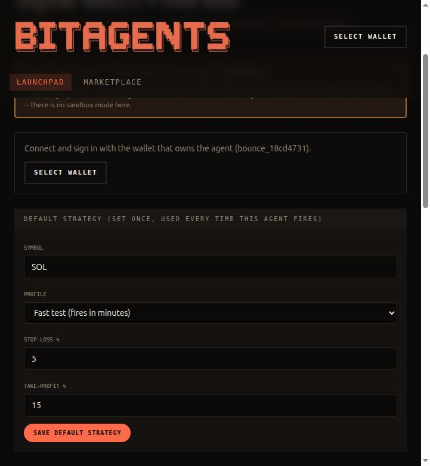
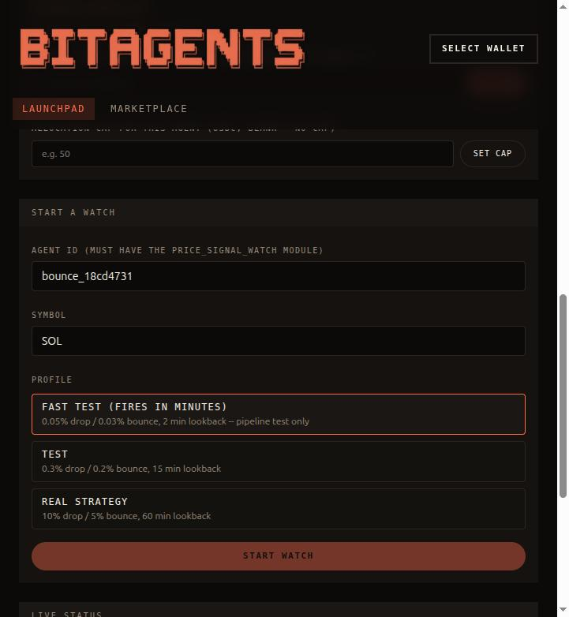
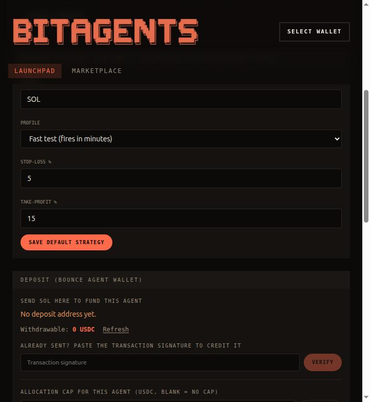
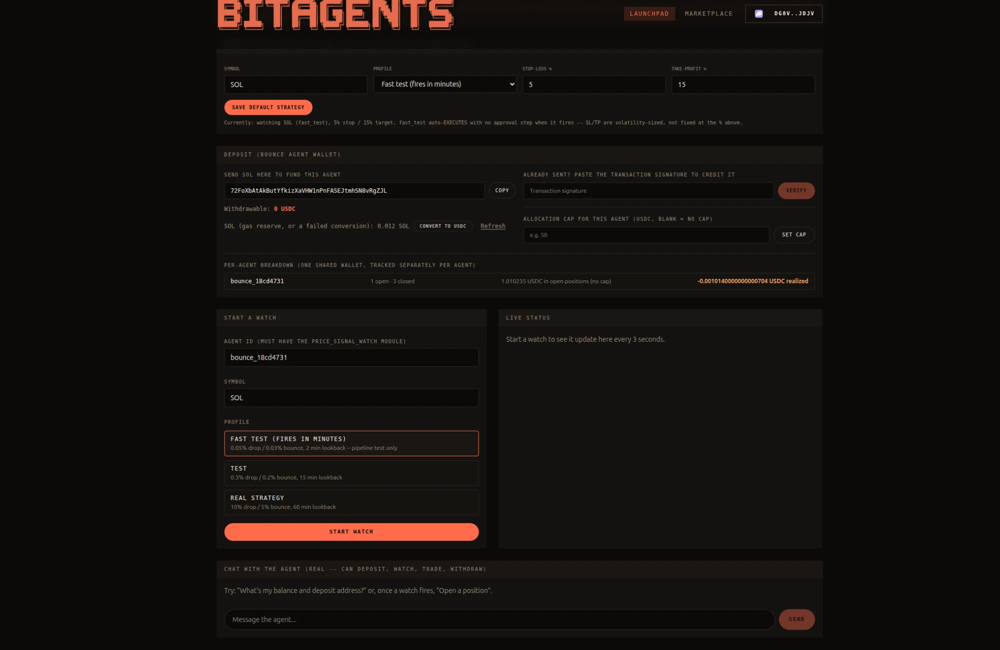
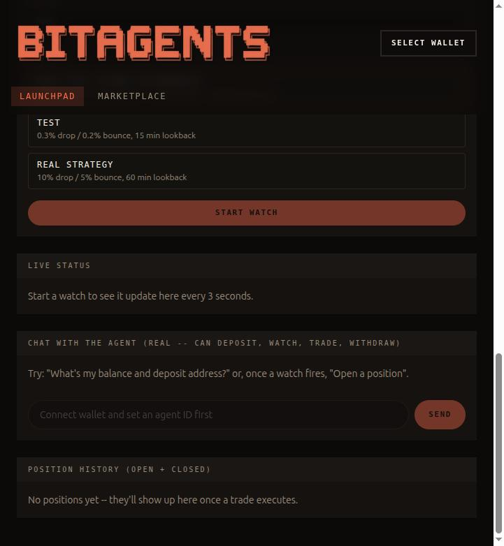

# Bounce Agent -- setup and usage guide

The Bounce Agent watches a token for a drop-then-bounce price pattern ("drops X%, then
bounces Y% off the low") and, once that fires, trades it with a stop-loss/take-profit.
It runs on **real Solana mainnet, with real funds** -- there is no sandbox or devnet mode
for this agent, because devnet can't run Jupiter swaps.

Branch: `bounce-agent-signal-engine`
Test page: `frontend/src/app/launch/signal-test/page.tsx` (route: `/launch/signal-test`)

This page is a local dev/test harness only. It is not linked from the real app and not
something a real user would ever see -- it exists so we can drive the agent directly
while it's still being proven out.

The screenshots below are from a real local run of this exact page. Most show the page
*before* you connect a wallet (since that step needs your own real wallet, not mine) --
one screenshot further down shows what it looks like once connected and funded, so you
know what to expect.

## ⚠️ Before you touch anything

- Every action on this page is a real transaction. There is no "undo."
- Only use small amounts (a few dollars of SOL/USDC) while testing.
- The `fast_test` profile trades **fully autonomously, with no approval step** -- once
  you start a watch on it, it will keep opening and closing real positions on its own
  for as long as the backend keeps running (see "Profiles" below).

## Setup

1. **Postgres.** A local Postgres instance must be running and reachable via
   `DATABASE_URL` in `agent/new/.env`.
2. **Solana mainnet config**, in `agent/new/.env`:
   ```
   SOLANA_CLUSTER=mainnet
   SOLANA_RPC_URL=<a real mainnet RPC endpoint>
   ```
3. **Circle wallet (same as DCA / Yield).** Configure `CIRCLE_API_KEY`,
   `CIRCLE_ENTITY_SECRET`, and optionally `CIRCLE_WALLET_SET_ID` in `agent/new/.env`.
   Bounce provisions a per-user Circle wallet with agent type `bounce`. Optional
   fallback only if Circle is unset: `BOUNCE_WALLET_PRIVATE_KEY` (throwaway keypair).
4. **Fund the Bounce deposit address** shown on `/launch/signal-test` with a small
   amount of real SOL (0.05 SOL is plenty to start -- see "Gas" below for why).
   Price oracle is **Binance** spot (`SOLUSDT`, etc.), polled every **1 second**.
5. Install dependencies and start both halves:
   ```
   # backend
   cd agent/new && pip install -r requirements.txt && python agents_api.py

   # frontend
   cd frontend && npm install && npm run dev
   ```
6. **Create your own test agent.** The page needs an `agent_id` that has the
   `price_signal_watch` module enabled and is owned by *your* wallet (not mine --
   you can't use `bounce_18cd4731`, that one's owned by a different wallet and you
   won't have access to it). Run, from `agent/new`:
   ```
   python scripts/create_test_bounce_agent.py <YOUR_SOLANA_WALLET_ADDRESS>
   ```
   This requires `MODE=development` in your `.env` (so the usual 1 SOL launch fee is
   skipped) and prints something like:
   ```
   Created test agent: 811b40f01122486e
   Owner wallet: <your address>
   ```
   Keep that agent ID -- you'll paste it into the page in step 2 below.
7. Open `http://localhost:3001/launch/signal-test`.

## Step-by-step usage

1. **Connect your wallet** (top right -- "Select wallet"). This must be the *same*
   wallet address you passed to the script in setup step 6.

   

2. **Set the Agent ID.** Scroll down to "Start a watch" and replace the Agent ID field
   with the ID the script printed (it defaults to my own test agent, `bounce_18cd4731`,
   which you don't own -- you must change this or everything below will 403).

   

3. **Deposit.** Back up at the "Deposit (Bounce Agent wallet)" panel, copy the deposit
   address shown, send a small amount of real SOL to it from any wallet, then paste the
   transaction signature into "Already sent? Paste the transaction signature to credit
   it" and hit **Verify**.

   

   - A SOL deposit is automatically converted to USDC on verification -- USDC is the
     agent's resting currency, not SOL. This is also what makes SOL itself a valid
     trade target (you can't buy SOL with SOL).
   - You can also send USDC directly to the same address and verify it the same way --
     no conversion needed, it's already the resting currency.
   - Once connected and funded, the panel fills in with your real balance and a
     per-agent breakdown, like this (different session, for illustration):

     

4. **Set a Default Strategy** (symbol, profile, stop-loss %, take-profit %), then
   **Save default strategy**. This is what gets used automatically whenever a matching
   watch fires. The % values you set here are a *baseline* -- the actual stop/target
   used on each trade is sized off the real recent price volatility, not applied
   literally (see "Volatility-sized stops" below).
5. **Start a watch** (symbol + profile, same panel as step 2). The Live Status panel
   polls every 1 second (Binance oracle): `neutral -> armed -> fired -> cooldown`.

   

6. **When it fires:**
   - `test` and `real` profiles stage a trade proposal -- an "Action needs your
     approval" card appears above the Deposit panel with the exact numbers; click
     **Approve** or **Reject**.
   - `fast_test` executes immediately, with no approval step (see below). An
     "Auto-executed" card shows what happened, inside the Live Status panel.
7. **Position history**, at the very bottom of the page, lists every open and closed
   position with clickable links to Solscan for the entry and close transactions.

## Profiles

| Profile | Thresholds | Fires in | Approval required? | Use for |
| --- | --- | --- | --- | --- |
| `fast_test` | 0.05% drop / 0.03% bounce | minutes | **No -- fully autonomous** | Proving the signal->trade pipeline works end to end. Thresholds are noise-level, not a real trading edge. |
| `test` | 0.3% drop / 0.2% bounce | tens of minutes | Yes | A faster-but-still-real dry run of the actual strategy shape. |
| `real` | 10% drop / 5% bounce | hours-days | Yes | The actual strategy as designed. |

`fast_test` is intentionally never meant to be offered to a real user's launched agent
-- it exists purely so this exact pipeline (signal -> arm -> fire -> execute -> close)
can be proven in a couple of minutes instead of waiting days for a genuine 10% move.

## Volatility-sized stops

Stop-loss and take-profit aren't applied as the flat percentage from your saved
strategy. At the moment a trade fires, the code measures the watch's own recent
rolling high/low range and sizes the stop off that -- a fixed 5% stop is too tight in
a genuinely volatile window (stops out on noise) and needlessly wide in a calm one.
The take-profit scales to preserve whatever stop:target ratio you configured. It's
bounded to 0.5x-3x of your configured stop so a dead-flat or freak-spike window can't
produce something degenerate.

## Gas

Each swap needs real SOL for network/priority fees and, sometimes, new token-account
rent -- roughly 0.008-0.016 SOL per leg, so a full open+close round trip is
~0.016-0.03 SOL. The agent wallet needs to keep a floor above this at all times or
swaps get rejected outright. If you see an error mentioning insufficient SOL, send a
bit more SOL to the agent's deposit address shown on the page.

## What's already been fixed / proven this round

- A real ledger-drift bug, where the ledger credited the pre-execution quote's
  estimated swap output instead of what actually settled on-chain -- fixed to read
  real settled amounts from the confirmed transaction.
- Swap routing restricted to deep-liquidity DEXes only, with automatic retry on a
  stale route.
- Full open -> close round trips tested live against real mainnet funds, with the
  ledger verified to match the real on-chain balance exactly afterward.
- The full `fast_test` auto-execute pipeline (watch fires -> trade opens -> position
  monitored -> closes on stop/target) tested live, unattended, end to end.

## Known gaps / things to be aware of

- No sandbox/devnet mode -- everything here is real mainnet money.
- Once a `fast_test` watch exists with auto-trade on, it keeps re-arming and trading
  indefinitely as long as the backend process is running, since its thresholds are
  noise-level and its cooldown is only 1 minute. It is not a one-shot.
- If the backend process is stopped while a position is open, that position's
  stop-loss/take-profit stops being monitored until the backend is restarted (the
  monitor is an in-process background thread).
