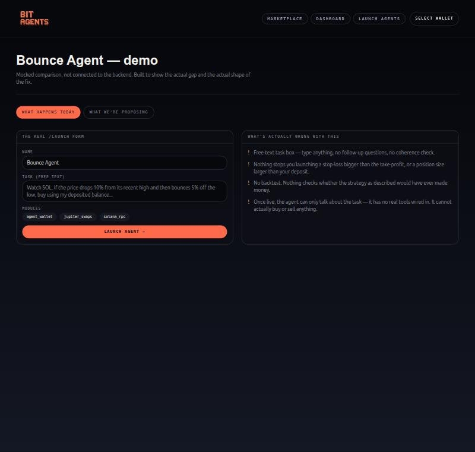
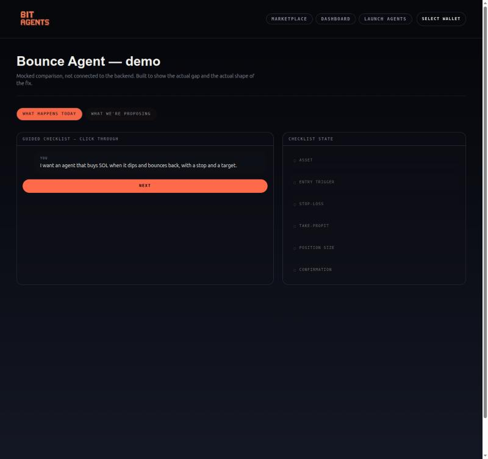
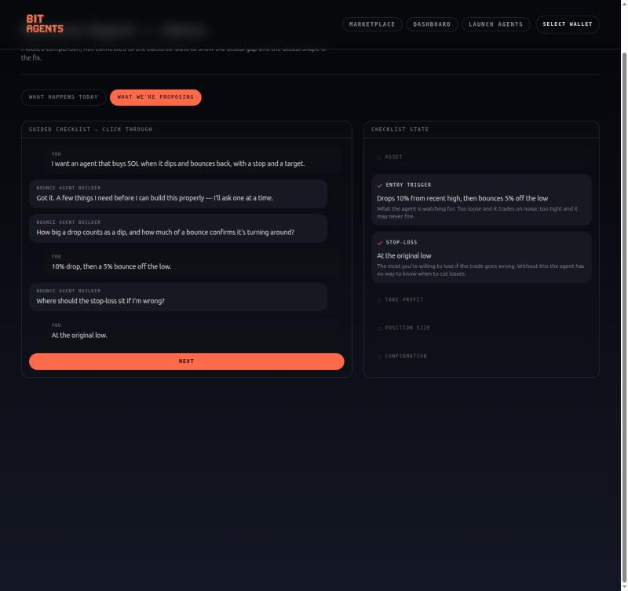
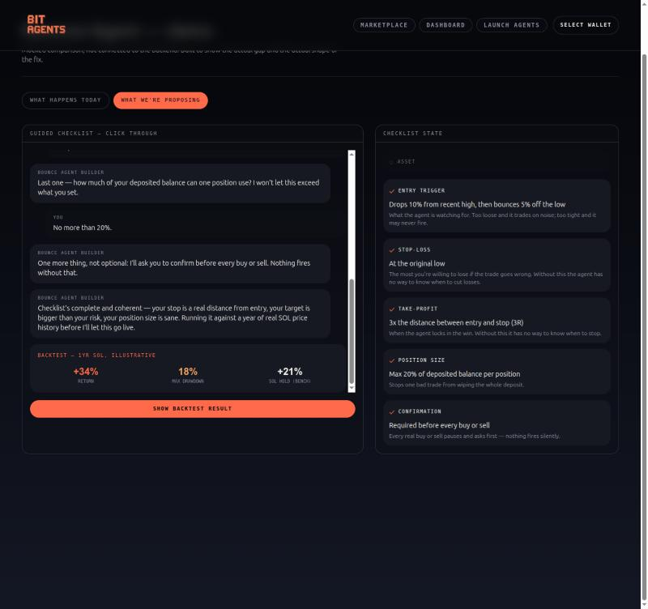

# Bounce Agent — the gap, and a proposed fix (demo)

This is a frontend-only mockup. It doesn't call the backend, launch a real
agent, or touch the database. It exists to make one point concrete: **what
actually happens today when someone tries to launch a trading-strategy
agent, vs. what we're proposing instead.**

## Why this exists

I ran the real `/launch` flow end-to-end to build a test strategy agent
("buy SOL when it dips and bounces, with a stop and a target"). It produces
a confident "agent launched" response, but:

1. The task box is free text — no follow-up questions, no coherence check.
   Nothing stops you entering a stop-loss bigger than your take-profit, or a
   position size larger than your deposit.
2. There's no backtest. Nothing checks whether the strategy as described
   would have ever made money.
3. Once live, the agent can only talk about the task — `chat_with_launched_agent()`
   calls the LLM with no `tools=` parameter, so `actions` is hardcoded to
   `[]`. It cannot actually buy or sell anything. This isn't a UX gap, the
   execution path is dead.

DCA already proves the fix pattern works — `dca_agent.py` has a real `TOOLS`
schema, a `CONFIRMATION_REQUIRED_TOOLS` safety gate, and a working
`tool_calls` dispatch loop. The launchpad just never got the same treatment.

## Run it yourself

```bash
cd frontend
npm install   # if you haven't already
npm run dev
```

Then open:

```
http://localhost:3000/launch/bounce-demo
```

(port may be 3000 or 3001 depending on what else is running — check your
terminal output)

Two tabs at the top:

- **What happens today** — the real `/launch` form, side by side with what's
  actually wrong with it.
- **What we're proposing** — click "Next" through a scripted conversation.
  Watch the right-hand "Checklist state" panel fill in as each field gets
  answered (entry trigger, stop-loss, take-profit, position size,
  confirmation requirement), ending in a backtest gate before the agent is
  allowed to go live.

No wallet, no backend call, no real LLM call — every line in the script and
every number in the backtest card is hardcoded for the demo. The point is
the *shape* of the fix, not the specific copy.

## Screenshots (in case you don't run it locally)

**What happens today** — free-text form next to the concrete list of what's
broken:



**What we're proposing — start of the guided checklist:**



**Mid-way through — checklist filling in as each question gets answered:**



**End state — full checklist plus the backtest gate (+34% return vs. +21%
SOL buy-and-hold benchmark) before "live" is allowed:**



## What I'd actually propose building (not in this demo)

Two separable, already partly-built pieces:

1. **Fix execution** — give `chat_with_launched_agent` a real tool registry
   and dispatch loop, reusing `dca_agent.py`'s existing pattern (`TOOLS`
   schema, `CONFIRMATION_REQUIRED_TOOLS`, `call_llm(..., tools=TOOLS)`, a
   `tool_calls` loop). Not a rebuild — DCA already proves this works, it
   just isn't wired up for launched agents.
2. **Add the backtest gate** — `covenant_pipeline.py` / `yahoo_market_data.py`
   already has `fetch_yahoo_daily_prices()` (keyless, SOL-mapped) and
   `compute_performance_metrics()` (real Sharpe/Sortino/drawdown vs.
   benchmark). What's missing is a signal-driven backtest runner — the
   existing `run_mock_backtest()` in `hedge_fund_core.py` only simulates
   static equal-weight rebalancing, not entry/exit on a rule like this.

Happy to walk through either of these live whenever works.
